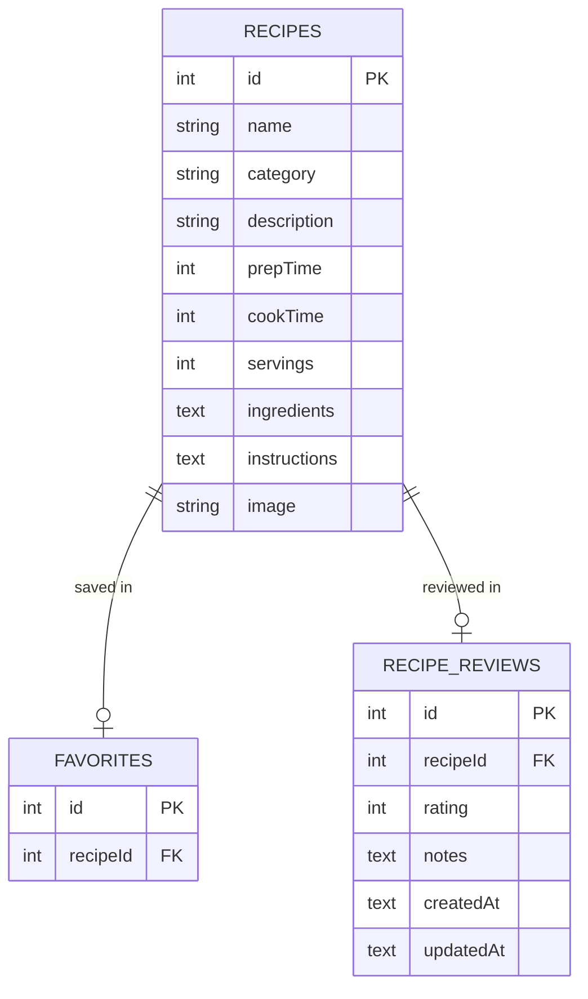

<div align="center">


# 🍳 RecipeHub
### *Your Favorite Recipes, Always Available Offline*

An offline-first mobile recipe management application built with **React Native**, **Expo SDK 58**, and **SQLite**. Designed for culinary enthusiasts, home cooks, and food lovers to explore, search, scale, review, listen to step-by-step instructions, and organize recipes anywhere, anytime — no internet required.

---

<!-- Badges -->
[](#)
[](#)
[](#)
[](#)
[](#)
[](#)
[](#)

</div>

---

## 🎯 Main Objectives

The fundamental purpose of **RecipeHub** is to eliminate dependence on active internet connectivity in the kitchen while providing a smooth, intuitive, and feature-rich digital cookbook.

| 🎯 Objective | 📝 Description |
| :--- | :--- |
| **📴 True Offline Accessibility** | Complete independence from network coverage. All recipe details, ingredients, preparation steps, and images remain accessible in remote locations, low-signal kitchens, or offline mode. |
| **⚡ Local SQLite Persistence** | Implement a reliable, local relational database (`expo-sqlite`) to ensure fast queries, atomic operations, and seamless data persistence across app restarts. |
| **🎙️ Voice Chef (Read Instructions)** | Hands-free culinary assistance powered by Text-to-Speech (`expo-speech`) that reads each cooking instruction aloud, with step-by-step progress tracking, repeat, pause/stop, and previous/next navigation. |
| **⚖️ Dynamic Serving Size Calculator** | Intelligently recalculate and rescale ingredient quantities in real time based on user-chosen serving counts (including fractional quantities, e.g., `1/2 cup`, `1.5 tbsp`). |
| **⭐ Personal Review & Rating System** | Enable users to document culinary experiments by rating each dish (1–5 stars) and saving custom cooking notes and personal tips. |
| **❤️ Favorites & Collection Management** | Allow instant one-tap bookmarking so users can compile and revisit their go-to daily and festive dishes. |
| **🔍 Multi-Attribute Instant Search** | Quick, responsive query filter across dish titles, categories, and ingredient keywords without lag. |
| **🎨 Polished & Accessible UI** | Deliver a modern culinary aesthetic using warm terracotta tones (`#E87945`), clean typography, soft card elevations, and custom iconography. |

---

## ✨ Key Features

```
📁 RecipeHub Features
├── 📱 Home Screen: Curated popular recipes, quick stats & category badges
├── 🔍 Instant Search: Search by name, cuisine, or specific ingredients
├── 🏷️ Category Explorer: Browse by Sri Lankan 🇱🇰, Asian 🥢, Desserts 🍰, Italian 🍝, etc.
├── 📖 Recipe Details:
│   ├── Edge-to-edge photography banner
│   ├── Total, Prep, and Cooking duration breakdowns
│   ├── 🔢 Interactive Serving Calculator (+ / - real-time scaling)
│   ├── Step-by-step numbered cooking instructions
│   ├── 🎙️ Voice Chef: Hands-free step-by-step speech reader
│   └── 🌟 Star Rating & Custom Cooking Notes
├── 🎙️ Voice Chef Screen:
│   ├── Step progress indicator (e.g., Step 2 of 6)
│   ├── Large instruction display
│   ├── Automated Text-to-Speech playback (`expo-speech`)
│   ├── Repeat instruction and Stop reading controls
│   └── Previous / Next navigation buttons
├── ❤️ Favorites Hub: Dedicated offline bookmarks with instant one-tap removal
└── ⚙️ App Settings & Diagnostics: Live recipe metrics, author attribution & contact card
```

### 1. 📴 100% Offline Database Architecture
- Built on **Expo SQLite (Async API)** with preloaded seed recipes and auto-sync migration logic.
- Relational schema connecting `recipes`, `favorites`, and `recipe_reviews`.
- Local bundled assets guarantee instant load times and zero network consumption.

### 2. 🎙️ Voice Chef (Audio Assistant)
- Reads cooking steps aloud using **`expo-speech`** so you can cook without touching the screen with messy hands.
- Features real-time step progress bars, replay buttons (`Repeat Instruction`), stop speech buttons, and step-by-step forward/backward navigation.

### 3. 🔢 Smart Serving Calculator
- Automatically detects fractional and decimal quantities (e.g., `2 godamba rotis`, `1/2 cup spring onions`, `1.5 cups milk`).
- Updates ingredient numbers instantly when increasing or decreasing the target serving size, preserving non-numeric units (such as `"Salt to taste"`).

### 4. ⭐ Interactive Reviews & Personal Notes
- Rate recipes from 1 to 5 stars.
- Write, update, and persist personalized culinary notes for future preparation adjustments.
- Dedicated modal alerts confirm review creations and deletions.

### 5. 🧭 Intuitive Tab & Stack Navigation
- Powered by **React Navigation v7** with bottom tabs and native stacks.
- Custom vector icons (`@expo/vector-icons` Ionicons) with active pill highlight styling matching the app's brand theme.

---

## 🎨 Color Palette & Design System

RecipeHub utilizes a warm, appetizing palette inspired by fresh ingredients and oven-baked culinary tones:

| Tone | Hex Code | Visual Preview | Purpose |
| :--- | :--- | :---: | :--- |
| **Primary Terracotta** | `#E87945` |  | Primary brand color, buttons, active tabs |
| **Primary Dark** | `#C85D2D` |  | Headers, badges, accents |
| **Warm Canvas** | `#FFF9F4` |  | App screen backgrounds |
| **Surface White** | `#FFFFFF` |  | Cards, modals, containers |
| **Charcoal Text** | `#292522` |  | Primary headings and labels |
| **Secondary Text** | `#8C8179` |  | Subtitles, timestamps, captions |
| **Warm Border** | `#F0E5DC` |  | Subtle hairline borders, card frames |
| **Accent Pastel** | `#FCEBDD` |  | Highlight tags, icon backdrops |

---

## 🗄️ Database Architecture

RecipeHub manages three relational tables locally on the device using SQLite:



---

## 📂 Project Structure

```bash
RecipeHub-Offline-Recipe-App/
├── assets/
│   ├── icon.png                      # Application launcher icon
│   ├── android-icon-*.png            # Adaptive Android launcher icons
│   └── images/                       # Local bundled recipe & branding assets
│       ├── logo.jpg                  # Official RecipeHub logo
│       ├── chicken-kottu.jpeg
│       ├── kiribath.jpeg
│       ├── chicken-biryani.jpeg
│       └── ...
├── src/
│   ├── database/                     # SQLite Database layer
│   │   ├── database.js               # DB initialization & table migration
│   │   ├── recipeData.js             # Initial recipe collection & queries
│   │   ├── favoritesData.js          # Favorites CRUD operations
│   │   ├── reviewsData.js            # Rating & Review CRUD operations
│   │   └── recipeImages.js           # Static image mappings
│   ├── navigation/
│   │   └── AppNavigator.js           # Bottom tabs & stack configuration
│   ├── screens/
│   │   ├── HomeScreen.js             # Welcome feed & popular recipes
│   │   ├── SearchScreen.js           # Search bar & category filtering
│   │   ├── CategoriesScreen.js       # Category cards & filtered listings
│   │   ├── FavoritesScreen.js        # Saved bookmarks
│   │   ├── RecipeDetailsScreen.js    # Serving scale, steps, voice chef trigger & reviews
│   │   ├── VoiceChefScreen.js        # Step-by-step audio assistant (expo-speech)
│   │   └── SettingsScreen.js         # App details, statistics, author & contact card
│   └── styles/
│       └── colors.js                 # Unified color system
├── App.js                            # App entry & DB bootstrap
├── app.json                          # Expo configuration & plugins
├── eas.json                          # EAS build configuration
└── package.json                      # Dependencies and scripts
```

---

## 🚀 Getting Started

Follow these instructions to run the application on your local machine or mobile device.

### Prerequisites
- [Node.js](https://nodejs.org/) (v18 or newer recommended)
- [npm](https://www.npmjs.com/) or [yarn](https://yarnpkg.com/)
- [Expo Go](https://expo.dev/go) installed on your Android or iOS device (or an Android/iOS emulator)

### 1. Clone the Repository
```bash
git clone https://github.com/SamudiniGunarathna/RecipeHub-Offline-Recipe-App.git
cd RecipeHub-Offline-Recipe-App
```

### 2. Install Dependencies
```bash
npx expo install
```

### 3. Start the Development Server
```bash
npx expo start
```

### 4. Run on Device / Emulator
- **Physical Device**: Scan the QR code displayed in the terminal using the **Expo Go** app (Android) or the native **Camera app** (iOS).
- **Android Emulator**: Press `a` in the terminal.
- **iOS Simulator**: Press `i` in the terminal.
- **Web Browser**: Press `w` in the terminal.

---

## 🛠️ Tech Stack & Libraries

- **Framework**: [React Native](https://reactnative.dev/) (v0.88.1)
- **Tooling**: [Expo SDK 58](https://docs.expo.dev/) (v58.0.25)
- **Local Storage**: [`expo-sqlite`](https://docs.expo.dev/versions/latest/sdk/sqlite/)
- **Voice Assistance (TTS)**: [`expo-speech`](https://docs.expo.dev/versions/latest/sdk/speech/)
- **Navigation**: [`@react-navigation/native`](https://reactnavigation.org/), Bottom Tabs, Native Stack
- **Icons**: [`@expo/vector-icons`](https://docs.expo.dev/guides/icons/) (Ionicons)
- **Typography & Assets**: [`expo-font`](https://docs.expo.dev/versions/latest/sdk/font/)

---

## 👩‍💻 Author & Attribution

**RecipeHub** was designed and implemented as an offline recipe application.

- **Developer**: Samudini Gunarathna
- **Degree**: BSc in IT - Faculty of Applied Sciences
- **Contact**: [samudinigunarathna@gmail.com](mailto:samudinigunarathna@gmail.com)
- **Copyright**: © 2026 RecipeHub. All rights reserved.

---

## 📄 License

This project is licensed under the [MIT License](LICENSE) — see the LICENSE file for details.
